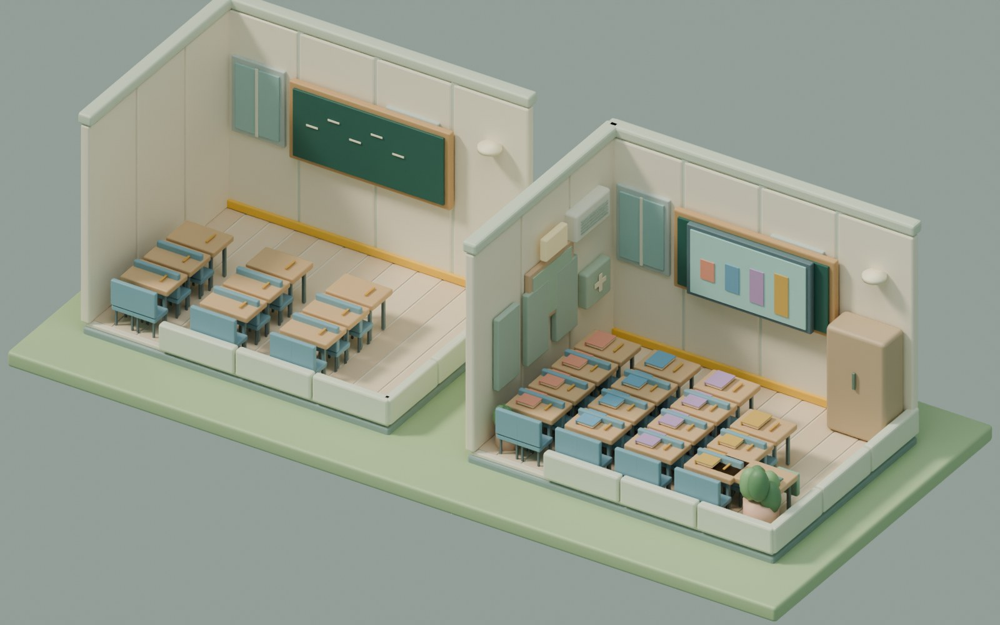

# Rektor · Godot 4 + Unity School Tycoon

**Godot-Port 0.6.0:** Das eigenständige Projekt liegt in [`Godot/`](Godot/). Godot und Unity verwenden denselben Simulationskern und dieselben 3D-Grafikrezepte. Das vollständige Unity-Projekt 0.5 bleibt erhalten und kann später weitergebaut werden. [Godot starten, Android bauen und beide Engines nutzen](docs/GODOT.md).

Baue eine Schule vom ersten Klassenzimmer zum mehrstöckigen Campus. Begleite Schüler über Schuljahre, entwickle Lehrkräfte, Wochenpläne und Fachräume und halte den Betrieb finanziell gesund.

**Umgesetzt:** Hauptmenü mit sechs Spielständen und Sicherungen, drei Schwierigkeitsstufen, Sandbox mit unendlich Geld, Einstellungen, 146 Fächer, individuelle Raumkäufe, zwölf Story-Kapitel und Touch-Bedienung. Das Quellprojekt und seine Prüfungen liegen vollständig in diesem Repository.

**Build-Stand:** Die Simulation und Unity-C#-API-Kompilierung sind geprüft. Eine fertige APK ist noch nicht verfügbar: Der lokale Unity-Lizenzdienst konnte nicht starten; die GitHub-Build-Prüfung fand keine hinterlegte Unity-Aktivierung. [Android-Build](docs/ANDROID.md) · [Prüfstand](docs/VALIDATION.md).

## Spiel starten

1. Dieses Repository mit **Unity 6000.0.65f1** öffnen.
2. `Assets/Scenes/Campus.unity` öffnen und Play starten.
3. Hauptmenü → Spielen → Spielstand → Entspannt / Ausgewogen / Anspruchsvoll. Der Sandbox-Einstieg besitzt eigene freie Plätze und unendlich Geld.
4. Wähle Geschlecht, Haare und Namen der Schulleitung. Mara führt durch den ersten Ausbau. Auf Smartphones befinden sich **Bauen** und **Verwalten** unten; beide lassen sich zuklappen.

Zum Fortsetzen einen gespeicherten Campus wählen. Eine neue Schwierigkeit startet eine neue Schule in diesem Platz; das Ersetzen braucht eine Bestätigung. Andere Plätze bleiben erhalten.

## Das Spiel

- **Schulbetrieb:** individuelle Schülerprofile, feste Klassen, Lehrkräfte, Förderung, Stress, Anwesenheit, Prüfungen, Versetzung und Abschlüsse nach frei gewähltem Jahrgang 6–13.
- **Fächer:** 146 integrierte Kurse, darunter alle 43 AP-Angebote der geprüften Liste. Deutsche, englische und US-Wochenplan-Vorlagen; bis zu 200 eigene Wahlfächer. [Details und Quellen](docs/CURRICULUM.md).
- **Gebäude:** 17 Raumtypen, sechs Geschosse, echte Treppenwege und tragende Räume. Obere Geschosse kosten mehr und werden in Kampagnen schrittweise zugänglich.
- **Ausstattung:** neue Kampagnen starten mit Grundmöbeln. 57 unterschiedliche Item-Typen, darunter zusätzliche Tischgruppen, Bücher, Mikroskope, Computer, Instrumente, Werkzeuge, Küche und Barrierefreiheit. Räume entwickeln sich über fünf Stufen. Dekoration folgt nach der funktionalen Ausstattung.
- **Langzeitspiel:** zwölf Kapitel mit Mara, vier Forschungsrichtungen, fünf AGs, zwölf Ereignisse und wechselnde jährliche Schulvisionen. Voraussetzungen verbinden Zeit, Ausbildung, Forschung und den Zustand der Schule.
- **Einstellungen:** Sprache, Musik und Effekte, Kamerageschwindigkeit, drei Grafikstufen, 30/60 FPS, weniger Bewegung, Raumnamen und automatisches Speichern.

## Schwierigkeiten

| Schwierigkeit | Startkapital | Förderung je Platz* | Kaufpreise | Betrieb/Gehälter | Schuldentoleranz |
|---|---:|---:|---:|---:|---:|
| Entspannt | 21.000 € | 24 € | 85 % | 90 % | 9 Tage / 8.000 € |
| Ausgewogen | 16.000 € | 20 € | 100 % | 100 % | 5 Tage / 5.000 € |
| Anspruchsvoll | 13.000 € | 18 € | 112 % | 110 % | 3 Tage / 3.500 € |

\* Erste 48 betreute Plätze erhalten den vollen Satz, die nächsten 48 erhalten 80 %, weitere 65 %. Unterrichtsmaterial, AGs und Förderung bleiben zusätzliche Kosten. Sandbox verbraucht kein Geld und kennt keine Zahlungsunfähigkeit; Wege, Plätze und Lehrkräfte bleiben Teil der Simulation.

Die Schwierigkeiten wurden über **720 Schultage** mit tatsächlich verdientem Geld geprüft. Alle drei erreichten zwölf Kapitel, Abschlussjahrgänge, Forschung, höhere Geschosse und jährliche Projekte. Die Tests zeigen nachhaltige Spielwege; sie ersetzen weitere menschliche Spieltests nicht. [Balancing und Freischaltungen](docs/BALANCING.md).

## Grafik

Eigene prozedurale 3D-Modelle mit abgerundeten Möbeln, Fachraum-Items, beweglichen Figuren, Glas, Holz, Pflanzungen, warmem Licht und optionaler Bildnachbearbeitung. Das Hauptmenü nutzt eine eigene generierte Campus-Illustration.



*Offline-Modellvorschau aus denselben C#-Grafikrezepten. Die Bildprüfung erfolgte in Blender. Eine Unity- oder Android-Aufnahme ist noch nicht verfügbar.* [Campus-Modellvorschau](docs/campus-model-preview.jpg) · [Art Direction](docs/ART_DIRECTION.md).

## Prüfen und bauen

```bash
python3 tools/validate_project.py
dotnet run --project tools/SchoolDomainTests.csproj --configuration Release
```

Die NUnit-Tests sind dieselben Dateien wie die Unity-Edit-Mode-Tests. GitHub Actions kompiliert und führt die Simulation aus. `tools/compile_unity_api.py` prüft Core, Runtime/UI und Editor zusätzlich gegen einen installierten offiziellen Unity-Editor; dies ist eine API-Kompilierung.

Build-Menü im Editor: **Rektor → Build → Windows / Linux / Android APK / WebGL**. Der Android-Workflow verwendet den tatsächlichen Unity-Spieler und erzeugt bei vorhandener Aktivierung `Builds/Android/Rektor-0.5.0.apk`. [Anleitung](docs/ANDROID.md).

Ältere valide Spielstände werden in Platz 1 übernommen, wenn dieser frei ist. Sie behalten ihr bisheriges Wirtschaftssystem, ihren Fortschritt und vorhandene Möbel. Neue Kampagnen verwenden das neue Balancing und die Ausstattungskäufe.

Konzept und Spielidee: **KoSch / The School Simulation**, eigenständige Unity-Umsetzung. Für die eigenen Quelltexte ist noch keine Veröffentlichungslizenz gewählt; Unity-Pakete behalten ihre jeweiligen Bedingungen.
